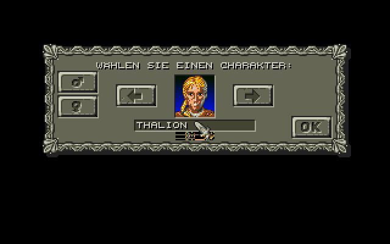
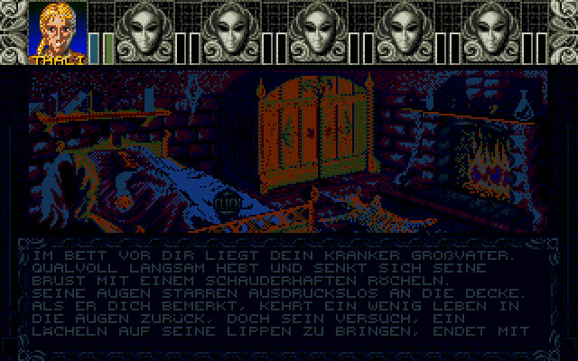
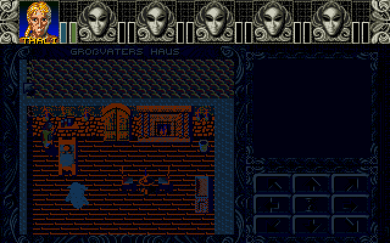

# Atari ST port of the original source – plan

The proof of concept (`src/`) re-implements the game routine by routine. The port (`port/`) instead
assembles the original source files of `AmbermoonSource/src` unchanged and replaces only the parts which
depend on the Amiga hardware by an ST kernel with the same interface.

## Findings

* The original is built as one include list (`AMBERMOON.S`). Without the Amiga kernel files
  (`KERNEL/SYSTEM.S`, `GRAPHICS.S`, `COLOURS.S`, `MOUSE.S`, `INPUT.S`, `FILES.S`, `FILES2.S`, `DI_SCREEN.S`,
  `ZOOM.S`, `START.S`, `MAP/3D_BLIT*.S`, `MUSIC/SONIC_ARRANGER.S`) the rest assembles for the 68000, and
  96 symbols are missing: this is the interface of the ST kernel (graphics, raster lists and fading,
  mouse and keyboard, files, zoom, 3D drawing, music, diagnostics screen).
* The game logic hardly touches the hardware: only two DMA accesses in `HULL/VARIOUS.S` (sound off).
  `FAIRY.S` is not part of the build.
* `MAP/3D_RENDER.S` uses 68020 instructions (`divsl.l`), because the original executable `AM2_CPU` needs a
  68020. These divisions need 68000 replacements.
* The memory manager (`KERNEL/MEMORY.S`) is plain 68000 code; only `Allocate_system_memory` calls the
  Amiga OS (`AllocMem`). The file system (`KERNEL/FILES.S`) needs GEMDOS instead of AmigaDOS.
* The game code uses the Amiga graphics format: planar data with 3, 4 or 5 planes (line interleaved) and a
  base colour, 32 colours. `Bytes_per_line` (200, 5 planes) is used for buffer sizes only, which also
  fit an ST screen (160 bytes per line).

## Design

* **Graphics:** the ST kernel draws the original Amiga graphics. A block is converted while it is drawn:
  Amiga colour (base colour + pixel value) → ST colour with the lookup table of the palette of the line
  (the raster lists of the proof of concept). Converted blocks are cached (key: source address, size,
  palette), so tiles, icons and fonts are converted once; the cache is cleared when the memory manager
  moves or frees memory.
* **Palettes:** like the proof of concept: 16 static colours per palette, precomputed per Amiga palette
  (`tools/st_convert.py`), raster lists split the screen.
* **Files:** the original containers (AMBR / AMPC / AMNP) are read with GEMDOS; the decompression is
  plain 68000 code.
* Original files which need small changes (memory allocation, file system calls, DMA) are copied to
  `port/PATCHED/` with every change marked `; ST:`.

## State

* Stage 1 and 2 are done, stage 3 is in progress: in Hatari (STE, 4 MB) the original code runs from the
  character editor through the first event (picture and scrolling text, the right mouse button ends it) to
  the 2D map of grandfather's house.
* The changes of the original files are patches (`port/PATCHES`, marked `; ST:`): memory allocation and blitter
  (`MEMORY.S`), sound DMA (`VARIOUS.S`), and the palette of an event picture is loaded before the picture is
  drawn (`EVENTS.S`), because the ST converts the colours while drawing (the Amiga screen keeps colour numbers).
* Open: the colours of the map look too dark (night?), music, zoom, 3D maps, diagnostic screen.

  

## Stages

1. Build: `port/AMBERST.S` assembles all original files with an ST kernel of stubs; the program links.
2. Kernel: system start, screens, raster lists, mouse, keyboard, memory allocation, files and
   decompression; the game starts and shows the first screen.
3. Graphics: drawing of the Amiga graphics with the conversion cache, text, windows, fading; the 2D map
   screen and the inventory work.
4. Combat (zoom of the monsters), effects.
5. 3D maps: 68000 replacements of the 68020 code, drawing of walls, floors and objects.
6. Music and sound (Sonic Arranger replay on the YM2149 / STE DMA sound).
