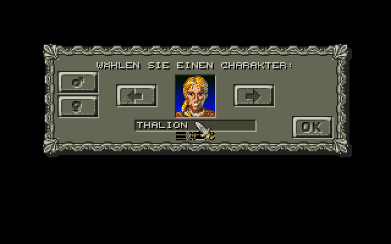
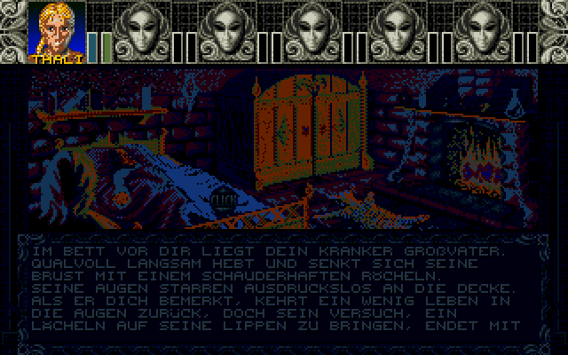
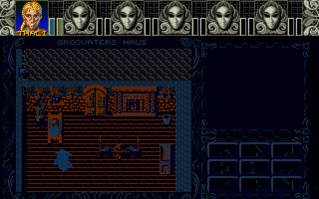

# Atari ST port of the original source – plan

The proof of concept (`src/`) re-implements the game routine by routine. The port (`port/`) instead
assembles the original source files of `AmbermoonSource/src` unchanged and replaces only the parts which
depend on the Amiga hardware by an ST kernel with the same interface.

Working notes for continuing the port (build, tests in Hatari, pitfalls, open points): [HANDOVER.md](HANDOVER.md).

## Findings

* The original is built as one include list (`AMBERMOON.S`). Without the Amiga kernel files
  (`KERNEL/SYSTEM.S`, `GRAPHICS.S`, `COLOURS.S`, `MOUSE.S`, `INPUT.S`, `FILES.S`, `FILES2.S`, `DI_SCREEN.S`,
  `ZOOM.S`, `START.S`, `MAP/3D_BLIT*.S`, `MUSIC/SONIC_ARRANGER.S`) the rest assembles for the 68000, and
  96 symbols are missing: this is the interface of the ST kernel (graphics, raster lists and fading,
  mouse and keyboard, files, zoom, 3D drawing, music, diagnostics screen).
* The game logic hardly touches the hardware: only two DMA accesses in `HULL/VARIOUS.S` (sound off).
  `FAIRY.S` is not part of the build.
* `MAP/3D_RENDER.S` uses 68020 instructions (`divsl.l`) only for floor and ceiling, which the game draws only on a
  68020 or better (`CPU_68020_plus`, like the A500 on the Amiga). `KERNEL/3D.S` assembles it with `machine 68020`, the
  rest of the renderer runs on the 68000 as it is.
* 3D maps: the renderer draws ST colours (the textures, horizons and the sky & floor colours of the lab data are
  converted by `port/tools/port_gfx.py` with the one lookup table of the 3D palettes, weighted by the colours of
  the textures in `port_palettes.py`), `Show_MOVEP_screen` puts the 3D view on the screen with `movep`. 4 to 2
  frames per second on an 8 MHz ST (the A500 has the blitter). Unpacked data of AMBR subfiles gets the space of
  its file (`PATCHES/FILES.diff` : the layout of the 3D maps was broken at the bottom).
* The memory manager (`KERNEL/MEMORY.S`) is plain 68000 code; only `Allocate_system_memory` calls the
  Amiga OS (`AllocMem`). The file system (`KERNEL/FILES.S`) needs GEMDOS instead of AmigaDOS.
* The game code uses the Amiga graphics format: planar data with 3, 4 or 5 planes (line interleaved) and a
  base colour, 32 colours. `Bytes_per_line` (200, 5 planes) is used for buffer sizes only, which also
  fit an ST screen (160 bytes per line).

## Design

* **Graphics:** the ST kernel draws the original Amiga graphics. A block is converted while it is drawn:
  Amiga colour (base colour + pixel value) → ST colour with the lookup table of the palette of the line
  (the raster lists of the proof of concept). Converted blocks are cached (key: source address, size,
  palette), so tiles, icons and fonts are converted once; the cache is cleared when the memory manager
  moves or frees memory.
* **Palettes:** like the proof of concept: 16 static colours per palette, precomputed per Amiga palette
  (`port/tools/port_palettes.py`), raster lists split the screen. The kernel finds the ST palette by the colours
  of the Amiga palette.
* **Files:** the original files of the German version are used unchanged (8.3 names, `port/tools/port_data.py`).
  `KERNEL/FILES.S` and `KERNEL/MEMORY.S` call dos.library and exec.library; the ST kernel has jump tables with
  the same offsets which call GEMDOS (`port/KERNEL/LIBS.S`).
* Original files which need small changes are patched (`port/PATCHES/*.diff`, every change marked `; ST:`).

## State

* Stage 1 and 2 are done, stage 3 is in progress: in Hatari (STE, 4 MB) the original code runs from the
  character editor through the first event (picture and scrolling text, the right mouse button ends it) to
  the 2D map of grandfather's house.
* The changes of the original files are patches (`port/PATCHES`, marked `; ST:`): memory allocation and blitter
  (`MEMORY.S`), sound DMA (`VARIOUS.S`), and the palette of an event picture is loaded before the picture is
  drawn (`EVENTS.S`), because the ST converts the colours while drawing (the Amiga screen keeps colour numbers).
* The ST palette of every palette of the raster list is found once, when its colours change (searching the
  table every frame made the vertical blank longer than a frame during fades: wrong colours in parts of
  the screen). The ST colours are faded like the Amiga colours they stand for.
* Memory: 2 MB are enough, 1 MB is not (the program ends at once).
* The fairy of Thalion, the intro and the main menu: the Amiga programs `Fantasy_intro` and `Ambermoon_intro` run
  as they are (`KERNEL/FANTASY.S`, `KERNEL/INTRO.S`, made from the executables by `port/tools/intro_source.py`,
  `fantasy_patch.py` and `intro_patch.py`; common with the Falcon). They draw into Amiga screens in memory, the
  blitter is done in software (`KERNEL/AMIGA_BLIT.S`), the start and the loading in `KERNEL/INTRO_COMMON.S`. Their
  data are the files `Intro_data` and `Fantasy_data` (`intro_data.py`), loaded into the last part of the BSS before
  the game allocates its memory; afterwards the program gives that memory back (`Mshrink`), so the game gets it.
  The hardware of the ST (`KERNEL/INTRO_HW.S`, `FANTASY_HW.S`): the Amiga screen is converted into the ST screen;
  the ST shows 200 of the up to 256 lines (with 236 the lower ones, the texts under the pictures; with 256 the
  middle; the fairy from line 21). The intro has 16 colours per picture, the colours 16-31 (the white stars, the
  texts and the pointer of the menu) get the nearest of them. The fairy has 32 colours and another 7 from line 134
  on: `port/tools/fantasy_st.py` makes 16 colours for the lines above and 16 for the lines from there on (the
  colours 0-19, the same in both, share 9 of them) and puts the ST colours into the graphics. The music of the
  intro is converted for the YM2149 (`sa_to_st.py intro` : `port/MUSIC/INTRO0.BIN` the intro, `INTRO1.BIN` the
  menu). The fairy is drawn natively (`FANTASY_HW.S`: the graphics in the format of the ST screen, three screens,
  `St_sprite` : masked sprites with the blitter of the STE or the processor).
* The intro itself is made anew for the ST (`KERNEL/INTRO_ST.S`, like `Intro.cs` of Ambermoon.net), the main
  menu stays the one of the Amiga program (also the menu entry INTRO plays the ST intro : `Intro_replay`,
  `Run_intro`). `port/tools/intro_st.py` makes the file `Intro_st` : the graphics in the format of the ST screen
  (the logos as frames of their zoom, the stars as their positions), and per tick the state of each scene (zoom,
  palettes, pages of the credits, sparks, towns, the meteor), computed like Intro.cs. The ST only draws : the
  state comes from the ticks (50 per second), when a frame takes longer the next one shows the right state, the
  intro stays with the music. Three screens; what was drawn into a screen is noted and cleared before it is drawn
  again. The planets, the sun and the meteor are scaled at run time (`Ist_scaled` : pixels * 16, per frame the
  columns once, per line of the object one line of chunks). Twinlake : the picture once, then the chunks which
  change. The end screen like the Amiga program (not like Ambermoon.net) : one palette (the colours 16-31 of
  palette 5, then palette 6), the main menu comes between the clouds in columns. The colours of a frame are given
  to the vertical blank before the screen is shown (`Ist_present` : the colours of the lines are made for the next
  frame). After the whole intro the main menu comes without a break, like the Amiga: the song of the intro goes
  on (its end is the music of the menu), its last picture stays in a screen outside the memory of the Amiga program
  while that program is loaded and makes the menu (`Intro_hold`), then the menu has its colours at once
  (`Intro_menu_in`).
  `Intro_st` is about 900 KB, the intro memory grows for it (BSS, given back afterwards). Speed on the STE : 50
  frames per second most of the time, about 18 when the sun or the meteor are big. Tests : `port/test/run.py`
  scenarios start with `nointro` (the game at once).
* Open: zoom (combat), extro, diagnostic screen, speed of the 3D maps (the STE blitter ?).

  

## Stages

1. Build: `port/AMBERST.S` assembles all original files with an ST kernel of stubs; the program links.
2. Kernel: system start, screens, raster lists, mouse, keyboard, memory allocation, files and
   decompression; the game starts and shows the first screen.
3. Graphics: drawing of the Amiga graphics with the conversion cache, text, windows, fading; the 2D map
   screen and the inventory work.
4. Combat (zoom of the monsters), effects.
5. 3D maps: 68000 replacements of the 68020 code, drawing of walls, floors and objects.
6. Music and sound (Sonic Arranger replay on the YM2149 / STE DMA sound).
