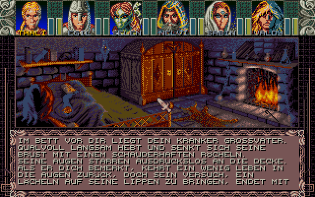
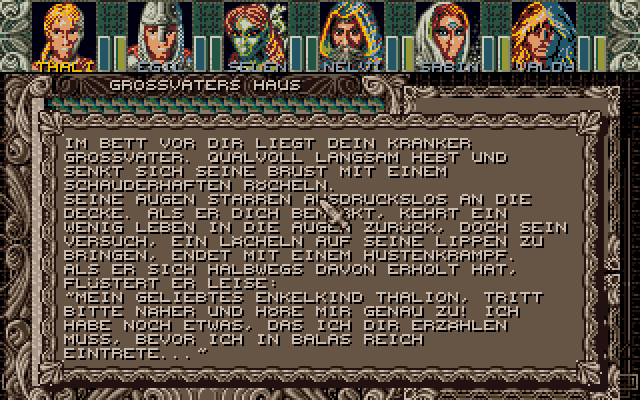
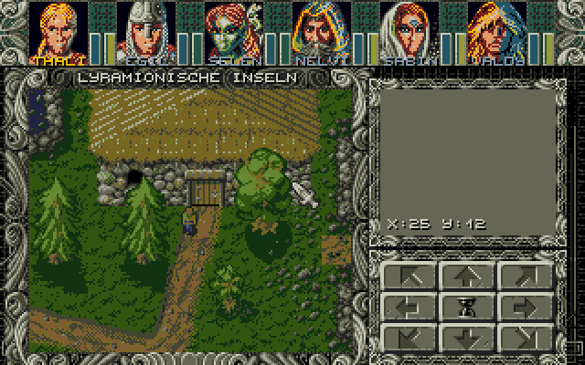
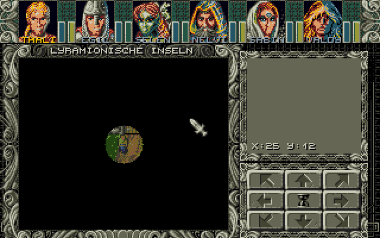
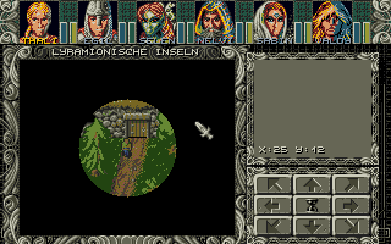
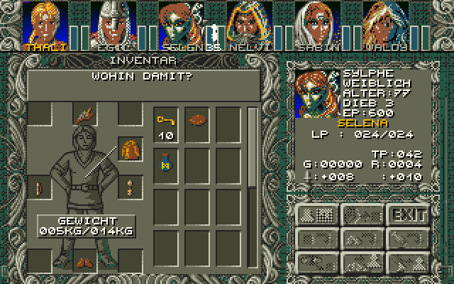
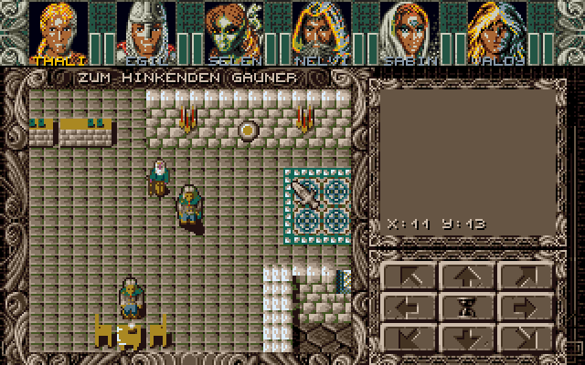

# Ambermoon for the Atari ST – proof of concept

This folder contains a proof of concept of an Atari ST port of Ambermoon, based on the source code in
`AmbermoonSource`. It shows the 2D map screen: the status block with the portraits and the LP/SP bars, the
2D map layout with the map name and the control icons, and the 2D maps. It starts like the game in map 258
"Großvaters Haus". The party can walk around, the map scrolls, the tiles are animated, and the persons
(NPCs) are shown and move on their paths or randomly while the time of day passes. Map events work for map
changes (e.g. out of the house onto the world map Lyramion and back), text popups (shown in a text window or
with their picture),
tile changes and conditions/actions on the bits of the savegame. All 2D city maps and the 2D world maps
can be reached. Outdoors there is a light circle around the party which depends on the time of day. The
inventory of the party members can be opened, and items can be moved between the backpack, the body and the
other party members. There is no music.

 

The picture text at the start of the game (the picture has its own 16 colour palette), the text popup
after it, and the world map in front of the house:

  

The world map at night (22:30, the start of the game) and at dusk (19:00):

 

The inventory of Selena (right mouse button on her portrait or F3) while her arrows are moved: they are shown as a
white silhouette, so they can be dragged onto the portraits, which have their own palette:



Map 264 "Zum hinkenden Gauner" at 14:00 (`./build.sh --map 264 --pos 11,13,2 --time 14:00`):



## Building and running

```
./build.sh                  # converts the data and assembles build/hd/AMBERST.PRG
./run_hatari.sh             # starts it in Hatari (STE, 1 MB)
```

* `build.sh` needs Python 3 with Pillow and `vasmm68k_mot` (set `VASM` to its path if it is not in `PATH`).
  By default the game starts like the initial savegame; `./build.sh --map 264 --pos 11,13,2 --time 14:00`
  starts in another 2D map (start position x, y, view direction, time of day).
* `build/hd` can be used as GEMDOS drive in Hatari or copied to a real ST with a hard disk
  (`AMBERST.PRG` and `DATA\`, about 6 MB). The maps and graphics are loaded while playing.
* `run_hatari.sh` uses Hatari's default TOS; set `TOS` to use another image, e.g. EmuTOS.

Controls: cursor keys or numeric keypad (also diagonally), or hold the left mouse button in the map window
or on a control icon. `ESC` or `UNDO` quits.

Inventory: right mouse button on a portrait or `F1` ... `F6`. The left mouse button on an item takes it (the
whole stack); then the left mouse button on a backpack slot, on the body or on a portrait puts it there, the
right mouse button or `ESC` puts it back. The name of the item under the mouse is shown above the mouse. The
exit icon or `ESC` closes the inventory.

## Target machine

STE with 1 MB. It also runs on a plain ST, but the colours are then rounded to 3 bits per channel (see
`Tools/AtariST` for a comparison) and the STE colour registers are written in STE format.

## How it works

### Colours

The Amiga version uses 32 colours. The ST has 16, so the screen is split like on the Amiga (the raster
lists in `MODULES.S`): the status block (lines 0–36) uses the UI palette, the layout and the map
(lines 37–199) use the map palette. Both 16 colour palettes have the same slot layout:

| ST colour | Contents |
|---|---|
| 0 | colour 0 (black, transparent for masked graphics) |
| 1–7 | 7 colours chosen per area (weighted k-means over the map tiles, portraits, party graphics) |
| 8–15 | the Amiga colours 24–31 (UI colours: layouts and all 3 bit graphics with base colour 24) |

For the status block, the colours of the LP bar (Amiga colours 7 and 6, blue) get their own ST colour, so
that they stay different from the SP bar (24 and 23, green).

The Amiga version uses one palette for the status block, the items and the portraits, because items can be
dragged onto the portraits. Here the inventory screen has its own palette below the status block, chosen for
the items and the portraits (the portrait of the inventory member is shown there too), and a moved item is
shown as a white silhouette like in Amberstar. White (Amiga colour 2) is ST colour 1 in both palettes, so the
silhouette looks the same over the portraits.

`tools/st_convert.py` converts all graphics in advance into the ST format (per line and 16 pixels 4 plane
words) with the final ST colours, and writes for each palette a lookup table Amiga colour → ST colour,
which the kernel uses for boxes and text colours.

### Kernel

The ST kernel (`src/KERNEL`) replaces the reconstructed Amiga kernel of `AmbermoonSource/src/KERNEL`. The
routines have the same names and parameters (`Put_masked_block`, `Put_unmasked_icon`, `Draw_box`,
`Push_CA`, `Set_raster_list`, `Put_text_line`, `Switch_screens`, `My_vsync`, …), so that the original
modules can use them later. The original include files (`CONSTANTS.I`, `MACROS.I`) and the structures of
`GAME_OFF.S` are included unchanged.

| ST file | Replaces (Amiga) | Contents |
|---|---|---|
| `KERNEL/START.S` | `KERNEL/START.S` | TOS start, supervisor mode, exit |
| `KERNEL/SYSTEM.S` | `KERNEL/SYSTEM.S` | Taking over and restoring the system (screen, MFP, vectors), VBL, double buffering |
| `KERNEL/COLOURS.S` | `KERNEL/COLOURS.S` | Raster lists (same format) via VBL + Timer B instead of the copper list, fading |
| `KERNEL/GRAPHICS.S` | `KERNEL/GRAPHICS.S` | Icons, blocks (masked, shifted, clipped), boxes, clip areas |
| `KERNEL/INPUT.S` | `KERNEL/INPUT.S` | Own ACIA interrupt: IKBD key codes and mouse packets |
| `KERNEL/MOUSE.S` | `KERNEL/MOUSE.S` | Mouse position and buttons, software mouse pointer (drawn before the screen switch) |
| `KERNEL/TEXT.S` | `KERNEL/TEXT.S` | Text output with the original font and glyph routines |
| `KERNEL/FILES.S` | `KERNEL/FILES.S` | Loading files with GEMDOS |
| `KERNEL/VARIOUS.S` | `HULL/VARIOUS.S` | `Random` (unchanged) |

The raster interrupts reproduce the copper list: a palette is set at the start of the line before its
line (that line is empty), and the colour gradient behind the portraits (`Portrait_range`, one colour per
line) is set by one Timer B interrupt per line.

### The 2D map

`src/POC/MAP2D.S` contains the routines of `MAP/2D_MAP.S`, `MAP/2D_CITY.S`, `MAP/MAP.S`, `DISPLAY.S` and
`HULL/CONTROLS.S` that are needed for the 2D map screen (display, tile animation, movement with collision
check, scrolling, status block, layout, control icons), without the module system, events and the memory
manager.

`src/POC/MAPLOAD.S` loads the maps (the graphics of a tileset, the NPC and party graphics only when they
change) and handles the 2D world maps: like the quad-maps of `MAP/2D_WILD.S`, but with the 3x3 submaps of
50x50 around the party in memory, so every position of the map window can be read directly. Loading during
the game is done with GEMDOS; only the TOS system timer (Timer C) is switched on for that.

`src/POC/EVENTS.S` contains the map events from `EVENTS.S` (event chains, map exit, text popup, change
icon, query and modify of the bit arrays of the savegame), the text window (`Open_window`,
`TxtW_DisInit`, text processing with word wrap and `~SELF~`) and the picture text screen (`Show_pictxt`: the
event picture with its own palette from line 37, the text paged 7 lines at a time below it).

`src/POC/LIGHT.S` contains the light from `MAP/2D_MAP.S` and `TIME.S`: always light (indoor), changing with
the time of day (outdoor, radius of the light circle per hour) or dark (only the party is visible). The
Amiga version erases the area outside the circle every frame; here the map positions are classified when
the circle changes (inside, edge, outside), positions outside are drawn black once and only the edge
positions are redrawn and erased line by line every frame.

`src/POC/INVENTORY.S` contains the Inventory 2 screen of `INVENTOR.S` and `DISPLAY.S`: the small member info,
the body items (with the cross over the other hand for double-handed weapons), the backpack with the scroll
bar, the weight, and moving items with the checks of the original (body place, class, sex, hands, fingers,
cursed items, stacks of up to 99) and its boni (damage, protection, LP/SP maximum, attributes, skills). The
text above the mouse and the moved item are drawn with the mouse pointer (`KERNEL/MOUSE.S`), like the HDOBs
of the Amiga version. The prompts ("Wohin damit?", ...) are the original messages.

`src/POC/PERSONS.S` contains the persons and the time from `PERSONS.S`, `TIME.S` and `MAP/MAP.S`: persons
on a path (one position per 5 minutes of the day) and randomly moving persons, sitting and sleeping
persons, collisions with persons, and the time of day, which advances by one step (5 minutes) every 4
moves or every 10 seconds. Monsters are shown, but stay where they are.

The Amiga version redraws the whole map window every frame with the blitter. On the ST this took 5 frames,
so a tile cache was added: for each screen buffer and map position the graphics drawn last time are
remembered, and only positions which changed (animations, party, scrolling) are redrawn. Measured in
Hatari (STE, 8 MHz):

| Situation | Frames per update |
|---|---|
| Standing (animations only) | 1 (50 updates per second) |
| Scrolling (whole map window) | 4 (a step takes 8 frames like on the Amiga, `M2_movement_speed`) |

## Not done yet

* Talking to persons, the other events (doors, chests, places, ...), monsters (movement, combat), light
  spells, transports and travel modes other than on foot, and 3D maps.
* In the inventory: the character screen (Inventory 1), using, dropping and viewing items, gold and food, and
  moving only a part of a stack.
* The module system, the memory manager and loading from the original containers (the data is converted in
  advance).
* Sound and music.
* Status icons of the party members.
