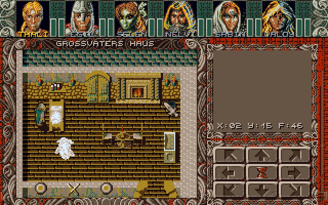
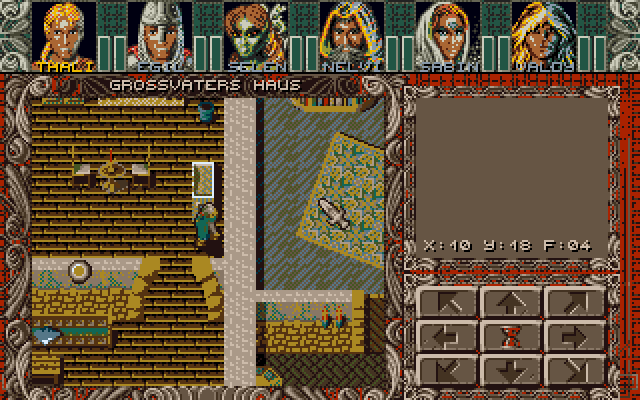

# Ambermoon for the Atari ST – proof of concept

This folder contains a proof of concept of an Atari ST port of Ambermoon, based on the source code in
`AmbermoonSource`. It shows the 2D map screen: the status block with the portraits, the 2D map layout with
the map name and the control icons, and a 2D map (by default map 258 "Großvaters Haus", where the game
starts). The party can walk around, the map scrolls and the tiles are animated. There is no music.

 

## Building and running

```
./build.sh                  # converts the data and assembles build/hd/AMBERST.PRG
./run_hatari.sh             # starts it in Hatari (STE, 1 MB)
```

* `build.sh` needs Python 3 with Pillow and `vasmm68k_mot` (set `VASM` to its path if it is not in `PATH`).
  `./build.sh --map 264 --pos 10,10,2` converts another 2D map (start position x, y, view direction).
* `build/hd` can be used as GEMDOS drive in Hatari or copied to a real ST (`AMBERST.PRG` and `DATA\`).
* `run_hatari.sh` uses Hatari's default TOS; set `TOS` to use another image, e.g. EmuTOS.

Controls: cursor keys or numeric keypad (also diagonally), or hold the left mouse button in the map window
or on a control icon. `ESC` or `UNDO` quits.

## Target machine

STE with 1 MB. It also runs on a plain ST, but the colours are then rounded to 3 bits per channel (see
`Tools/AtariST` for a comparison) and the STE colour registers are written in STE format.

## How it works

### Colours

The Amiga version uses 32 colours. The ST has 16, so the screen is split like on the Amiga (the raster
lists in `MODULES.S`): the status block (lines 0–36) uses the UI palette, the layout and the map
(lines 37–199) use the map palette. Both 16 colour palettes have the same slot layout:

| ST colour | Contents |
|---|---|
| 0 | colour 0 (black, transparent for masked graphics) |
| 1–7 | 7 colours chosen per area (weighted k-means over the map tiles, portraits, party graphics) |
| 8–15 | the Amiga colours 24–31 (UI colours: layouts and all 3 bit graphics with base colour 24) |

`tools/st_convert.py` converts all graphics in advance into the ST format (per line and 16 pixels 4 plane
words) with the final ST colours, and writes for each palette a lookup table Amiga colour → ST colour,
which the kernel uses for boxes and text colours.

### Kernel

The ST kernel (`src/KERNEL`) replaces the reconstructed Amiga kernel of `AmbermoonSource/src/KERNEL`. The
routines have the same names and parameters (`Put_masked_block`, `Put_unmasked_icon`, `Draw_box`,
`Push_CA`, `Set_raster_list`, `Put_text_line`, `Switch_screens`, `My_vsync`, …), so that the original
modules can use them later. The original include files (`CONSTANTS.I`, `MACROS.I`) and the structures of
`GAME_OFF.S` are included unchanged.

| ST file | Replaces (Amiga) | Contents |
|---|---|---|
| `KERNEL/START.S` | `KERNEL/START.S` | TOS start, supervisor mode, exit |
| `KERNEL/SYSTEM.S` | `KERNEL/SYSTEM.S` | Taking over and restoring the system (screen, MFP, vectors), VBL, double buffering |
| `KERNEL/COLOURS.S` | `KERNEL/COLOURS.S` | Raster lists (same format) via VBL + Timer B instead of the copper list, fading |
| `KERNEL/GRAPHICS.S` | `KERNEL/GRAPHICS.S` | Icons, blocks (masked, shifted, clipped), boxes, clip areas |
| `KERNEL/INPUT.S` | `KERNEL/INPUT.S` | Own ACIA interrupt: IKBD key codes and mouse packets |
| `KERNEL/MOUSE.S` | `KERNEL/MOUSE.S` | Mouse position and buttons, software mouse pointer (drawn before the screen switch) |
| `KERNEL/TEXT.S` | `KERNEL/TEXT.S` | Text output with the original font and glyph routines |
| `KERNEL/FILES.S` | `KERNEL/FILES.S` | Loading files with GEMDOS |
| `KERNEL/VARIOUS.S` | `HULL/VARIOUS.S` | `Random` (unchanged) |

The raster interrupts reproduce the copper list: a palette is set at the start of the line before its
line (that line is empty), and the colour gradient behind the portraits (`Portrait_range`, one colour per
line) is set by one Timer B interrupt per line.

### The 2D map

`src/POC/MAP2D.S` contains the routines of `MAP/2D_MAP.S`, `MAP/2D_CITY.S`, `MAP/MAP.S`, `DISPLAY.S` and
`HULL/CONTROLS.S` that are needed for the 2D map screen (display, tile animation, movement with collision
check, scrolling, status block, layout, control icons), without the module system, events, NPCs and the
memory manager.

The Amiga version redraws the whole map window every frame with the blitter. On the ST this took 5 frames,
so a tile cache was added: for each screen buffer and map position the graphics drawn last time are
remembered, and only positions which changed (animations, party, scrolling) are redrawn. Measured in
Hatari (STE, 8 MHz):

| Situation | Frames per update |
|---|---|
| Standing (animations only) | 1 (50 updates per second) |
| Scrolling (whole map window) | 4 (a step takes 8 frames like on the Amiga, `M2_movement_speed`) |

## Not done yet

* NPCs, events, darkness/light circle, transports, the 2D world maps and 3D maps.
* The module system, the memory manager and loading from the original containers (the data is converted in
  advance).
* Sound and music.
* Status icons and bars of the party members.
