# Ambermoon for the Atari ST – proof of concept

This folder contains a proof of concept of an Atari ST port of Ambermoon, based on the source code in
`AmbermoonSource`. It shows the 2D map screen: the status block with the portraits and the LP/SP bars, the
2D map layout with the map name and the control icons, and the 2D maps. It starts like the game in map 258
"Großvaters Haus". The party can walk around, the map scrolls, the tiles are animated, and the persons
(NPCs) are shown and move on their paths or randomly while the time of day passes. Map events work for map
changes (e.g. out of the house onto the world map Lyramion and back), text popups (shown in a text window or
with their picture),
tile changes and conditions/actions on the bits of the savegame. All 2D city maps and the 2D world maps
can be reached. Outdoors there is a light circle around the party which depends on the time of day. The
inventory of the party members can be opened, and items can be moved between the backpack, the body and the
other party members; items can be used (a subset of the spells), viewed and dropped. Doors and chests open
their own screen (pick the lock, use a key or lockpick, find and disarm traps, take the items, gold and food),
and persons can be talked to (the hand and mouth actions of the second control icon list or the right mouse
button on the map), also the party members (mouth on the party), who can leave the party and join it again. Traps, chance and data change events work, with the damage bursts, condition icons and
deaths in the status block. Places can be entered: trainers, healers, sages, inns (renting a room and resting in
the camp), merchants and libraries, blacksmiths. The party can camp (Camp icon), rest and learn spells from
spell scrolls. On the world maps the parked horses, rafts and ships can be used (Change travel mode icon), the
transport merchants sell them, and the party swims in the water. Monsters on the map hunt the party, and encounters lead to the
combat screen (moving, advancing, close- and long-range attacks, parading, fleeing, the monster logic of the
original, loot and experience). There is no music.

 

The picture text at the start of the game (the picture has its own 16 colour palette), the text popup
after it, and the world map in front of the house:

  

The world map at night (22:30, the start of the game) and at dusk (19:00):

 

The inventory of Selena (right mouse button on her portrait or F3) while her arrows are moved: they are shown as a
white silhouette, so they can be dragged onto the portraits, which have their own palette:


The character screen of Sabine (Stats icon in the inventory):

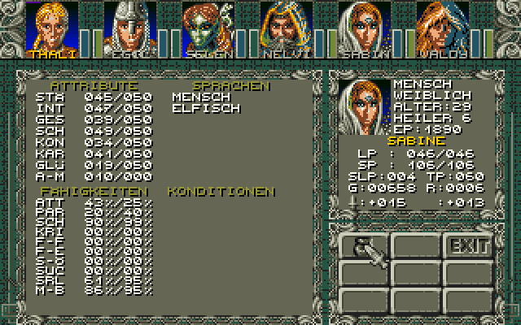

A locked door in the cell block and the chest in grandfather's house (Hand icon on the second control icon list,
right mouse button on the control icons):

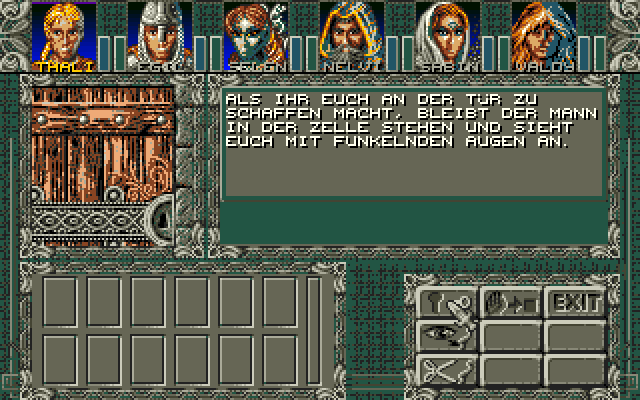 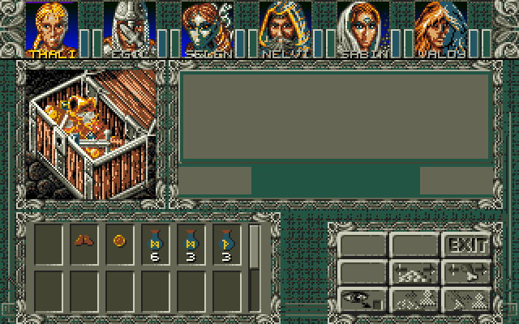

Talking to grandfather (right mouse button on him): the greeting, the word selector (Talk icon) and his answer:

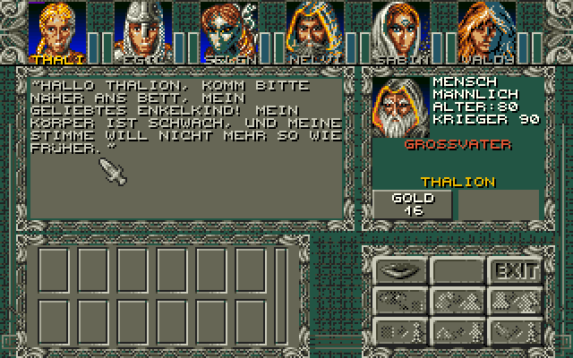 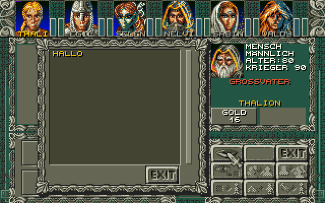 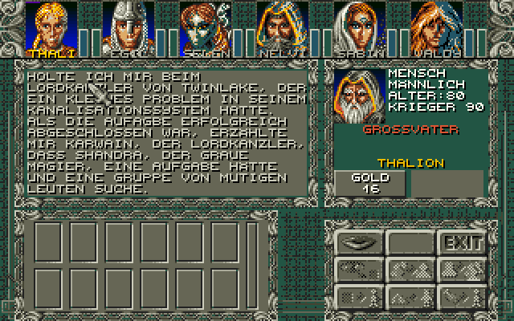

Giving gold to grandfather (he is not interested):

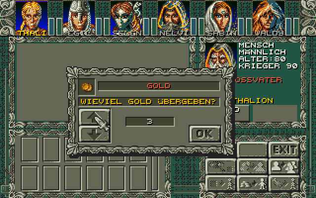

Sabine leaves the party (mouth on the party, her portrait, Leave icon) in the healer's house of Burnville
(map 286, `./build.sh --map 286 --pos 8,14,3 --time 12:00`), and joins again when she is talked to there:

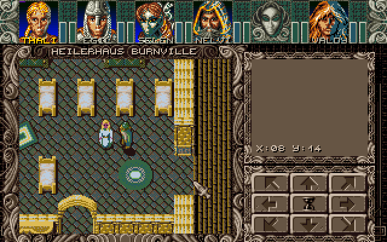 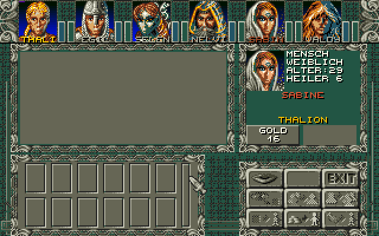

A merchant (map 287, Theresa's Schmuckladen): the price of an item is shown above its name, buying asks with the
original requester; a trainer (map 290) asks with the number input window:

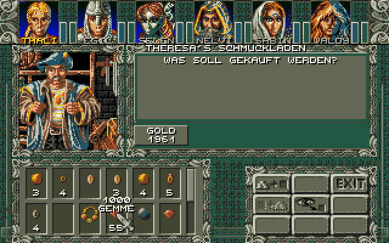 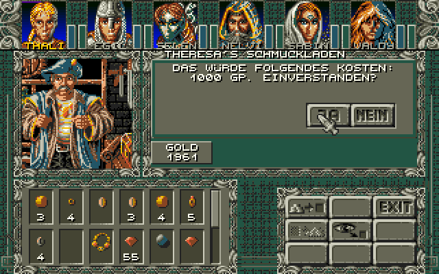 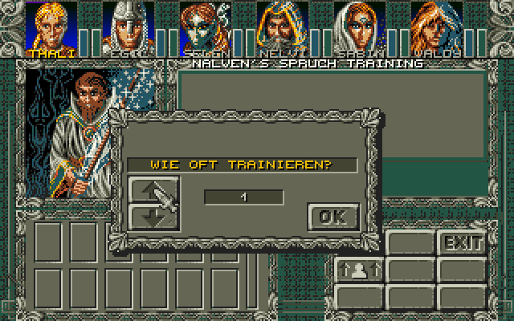

Resting in the camp after renting a room (map 266), and a trap that kills (changed test data) with the death
masks and the cross icons:

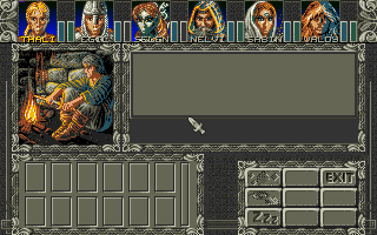 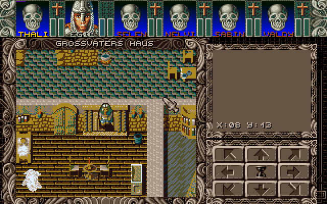

Combat on Kire's moon at night (encounter at 29,4 of map 300, `./build.sh --map 300 --pos 29,5,0`): the monsters
are zoomed like the COMOBs of the original, Thalion is hit (the scratches), and after a won battle the loot is
divided on the screen of the trash pile:

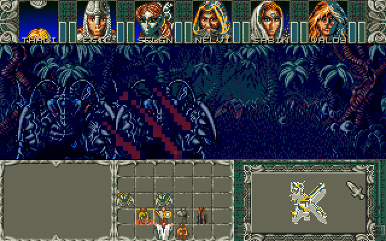 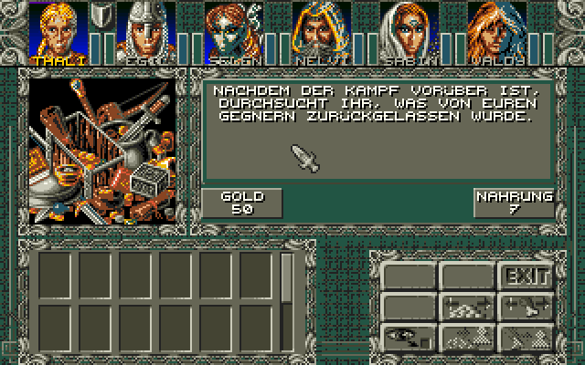

A hunting monster reaches the party (map 275) and the combat in the cave:

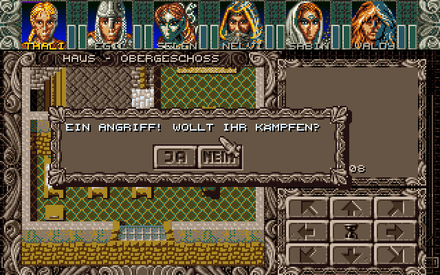 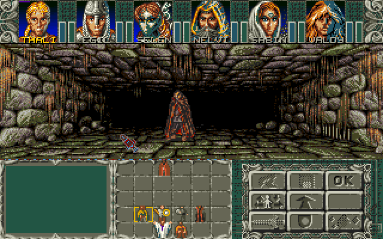

Learning a spell from a scroll in the camp (Read scroll icon; here Thalion got the scroll "Licht" in the test
data, and the attempt fails):

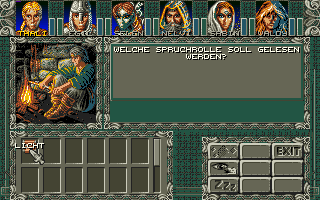 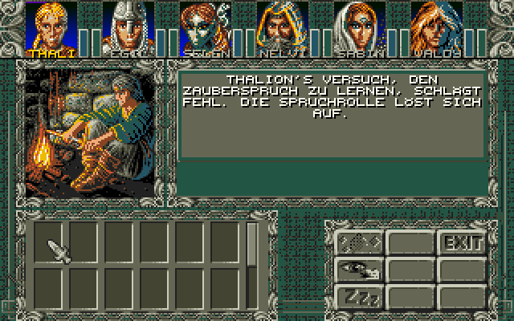

The raft of the savegame at the pier of map 171 (`./build.sh --map 171 --pos 21,42,0 --time 12:00`): the party
gets on (Change travel mode icon) and sails; left in the water, it has to swim (damage):

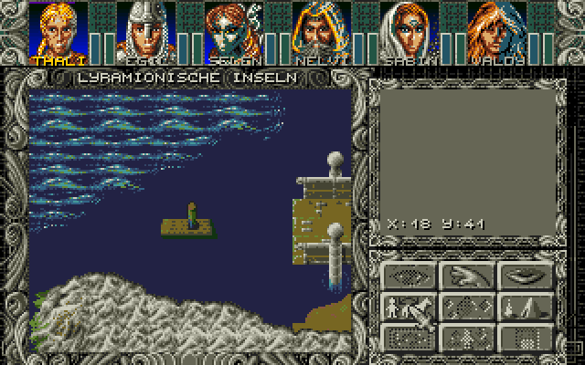 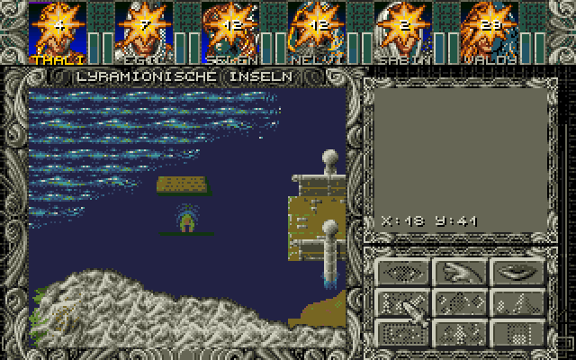

Map 264 "Zum hinkenden Gauner" at 14:00 (`./build.sh --map 264 --pos 11,13,2 --time 14:00`):


## Building and running

```
./build.sh                  # converts the data and assembles build/hd/AMBERST.PRG
./run_hatari.sh             # starts it in Hatari (STE, 1 MB)
```

* `build.sh` needs Python 3 with Pillow and `vasmm68k_mot` (set `VASM` to its path if it is not in `PATH`).
  By default the game starts like the initial savegame; `./build.sh --map 264 --pos 11,13,2 --time 14:00`
  starts in another 2D map (start position x, y, view direction, time of day).
* `build/hd` can be used as GEMDOS drive in Hatari or copied to a real ST with a hard disk
  (`AMBERST.PRG` and `DATA\`, about 6 MB). The maps and graphics are loaded while playing.
* `run_hatari.sh` uses Hatari's default TOS; set `TOS` to use another image, e.g. EmuTOS.

Controls: cursor keys or numeric keypad (also diagonally), or hold the left mouse button in the map window
or on a control icon. `ESC` or `UNDO` quits.

Inventory: right mouse button on a portrait or `F1` ... `F6`. The left mouse button on an item takes it (the
whole stack); then the left mouse button on a backpack slot, on the body or on a portrait puts it there, the
right mouse button or `ESC` puts it back. The name of the item under the mouse is shown above the mouse. The
Stats icon shows the character screen, the backpack icon goes back. The exit icon or `ESC` closes the
inventory.

## Target machine

STE with 1 MB. It also runs on a plain ST, but the colours are then rounded to 3 bits per channel (see
`Tools/AtariST` for a comparison) and the STE colour registers are written in STE format.

## How it works

### Colours

The Amiga version uses 32 colours. The ST has 16, so the screen is split like on the Amiga (the raster
lists in `MODULES.S`): the status block (lines 0–36) uses the UI palette, the layout and the map
(lines 37–199) use the map palette. Both 16 colour palettes have the same slot layout:

| ST colour | Contents |
|---|---|
| 0 | colour 0 (black, transparent for masked graphics) |
| 1–7 | 7 colours chosen per area (weighted k-means over the map tiles, portraits, party graphics) |
| 8–15 | the Amiga colours 24–31 (UI colours: layouts and all 3 bit graphics with base colour 24) |

For the status block, the colours of the LP bar (Amiga colours 7 and 6, blue) get their own ST colour, so
that they stay different from the SP bar (24 and 23, green).

In the palettes of the status block, the inventory and the character screen (`UIPAL`, `INVPAL`, `CHARPAL`),
ST colour 8 is a dark grey ($333) instead of Amiga colour 24 (a dark green, $254): that is the background of
the layouts (value 0), so the screens with layouts look grey. The graphics which use colour 24 themselves (the
SP bar, portraits, items) get one of the chosen colours for it (it takes part in the k-means there).

The Amiga version uses one palette for the status block, the items and the portraits, because items can be
dragged onto the portraits. Here the inventory screen has its own palette below the status block, chosen for
the items and the portraits (the portrait of the inventory member is shown there too), and a moved item is
shown as a white silhouette like in Amberstar. White (Amiga colour 2) is ST colour 1 in both palettes, so the
silhouette looks the same over the portraits. The character screen shows no items, so it has another palette
there, for the portrait, the status icons and the text colours (the headlines are light green).

`tools/st_convert.py` converts all graphics in advance into the ST format (per line and 16 pixels 4 plane
words) with the final ST colours, and writes for each palette a lookup table Amiga colour → ST colour,
which the kernel uses for boxes and text colours.

### Kernel

The ST kernel (`src/KERNEL`) replaces the reconstructed Amiga kernel of `AmbermoonSource/src/KERNEL`. The
routines have the same names and parameters (`Put_masked_block`, `Put_unmasked_icon`, `Draw_box`,
`Push_CA`, `Set_raster_list`, `Put_text_line`, `Switch_screens`, `My_vsync`, …), so that the original
modules can use them later. The original include files (`CONSTANTS.I`, `MACROS.I`) and the structures of
`GAME_OFF.S` are included unchanged.

| ST file | Replaces (Amiga) | Contents |
|---|---|---|
| `KERNEL/START.S` | `KERNEL/START.S` | TOS start, supervisor mode, exit |
| `KERNEL/SYSTEM.S` | `KERNEL/SYSTEM.S` | Taking over and restoring the system (screen, MFP, vectors), VBL, double buffering |
| `KERNEL/COLOURS.S` | `KERNEL/COLOURS.S` | Raster lists (same format) via VBL + Timer B instead of the copper list, fading |
| `KERNEL/GRAPHICS.S` | `KERNEL/GRAPHICS.S` | Icons, blocks (masked, shifted, clipped), boxes, clip areas |
| `KERNEL/INPUT.S` | `KERNEL/INPUT.S` | Own ACIA interrupt: IKBD key codes and mouse packets |
| `KERNEL/MOUSE.S` | `KERNEL/MOUSE.S` | Mouse position and buttons, software mouse pointer (drawn before the screen switch) |
| `KERNEL/TEXT.S` | `KERNEL/TEXT.S` | Text output with the original font and glyph routines |
| `KERNEL/FILES.S` | `KERNEL/FILES.S` | Loading files with GEMDOS |
| `KERNEL/VARIOUS.S` | `HULL/VARIOUS.S` | `Random` (unchanged) |

The raster interrupts reproduce the copper list: a palette is set at the start of the line before its
line (that line is empty), and the colour gradient behind the portraits (`Portrait_range`, one colour per
line) is set by one Timer B interrupt per line.

### The 2D map

`src/POC/MAP2D.S` contains the routines of `MAP/2D_MAP.S`, `MAP/2D_CITY.S`, `MAP/MAP.S`, `DISPLAY.S` and
`HULL/CONTROLS.S` that are needed for the 2D map screen (display, tile animation, movement with collision
check, scrolling, status block, layout, control icons), without the module system, events and the memory
manager.

`src/POC/MAPLOAD.S` loads the maps (the graphics of a tileset, the NPC and party graphics only when they
change) and handles the 2D world maps: like the quad-maps of `MAP/2D_WILD.S`, but with the 3x3 submaps of
50x50 around the party in memory, so every position of the map window can be read directly. Loading during
the game is done with GEMDOS; only the TOS system timer (Timer C) is switched on for that.

`src/POC/EVENTS.S` contains the map events from `EVENTS.S` (event chains, map exit, text popup, change
icon, query and modify of the bit arrays of the savegame), the text window (`Open_window`,
`TxtW_DisInit`, text processing with word wrap and `~SELF~`) and the picture text screen (`Show_pictxt`: the
event picture with its own palette from line 37, the text paged 7 lines at a time below it).

`src/POC/LIGHT.S` contains the light from `MAP/2D_MAP.S` and `TIME.S`: always light (indoor), changing with
the time of day (outdoor, radius of the light circle per hour) or dark (only the party is visible). The
Amiga version erases the area outside the circle every frame; here the map positions are classified when
the circle changes (inside, edge, outside), positions outside are drawn black once and only the edge
positions are redrawn and erased line by line every frame.

`src/POC/INVENTORY.S` contains the Inventory 2 screen of `INVENTOR.S` and `DISPLAY.S`: the small member info,
the body items (with the cross over the other hand for double-handed weapons), the backpack with the scroll
bar, the weight, and moving items with the checks of the original (body place, class, sex, hands, fingers,
cursed items, stacks of up to 99) and its boni (damage, protection, LP/SP maximum, attributes, skills). The
text above the mouse and the moved item are drawn with the mouse pointer (`KERNEL/MOUSE.S`), like the HDOBs
of the Amiga version. The prompts ("Wohin damit?", ...) are the original messages. The Inventory 1 screen
(character screen) shows the attributes, skills, languages and conditions (status icons, with their names
above the mouse).

`src/POC/ITEMS.S` contains using, viewing and dropping items (`INVENTOR.S`, `MAGIC.S`), the accept/refuse
status icons on the portraits while an item is moved and the yes/no requester. Only a few spells can be
used from items in the proof of concept; the others give the original message that it is not possible here.

`src/POC/CHEST.S` contains the door and chest events (`EVENTS.S`, `LAYOUT3.S`): the 80x80 picture with the
inventory palette, the texts, opening the lock (pick lock, key, lockpick, traps), and taking items, gold and
food. The contents of the chests come from the savegame (`Save.00`) and are written back when they change.

`src/POC/DIALOGUE.S` contains talking to persons (`DIALOGUE.S`, `WORD_SEL.S`): short dialogues are shown in
the text window, long ones open the dialogue screen with the portrait (all 102 portraits share one static
palette that is computed in advance by the converter) and the info of the person. The dialogue events of the
person (greeting, asked words, farewell) are processed with their texts, queries (party members, items,
words, conditions, gold, food) and modifications of the bit arrays, and new words are added to the known
words. Items can be shown and given (the item moves from its slot to the portrait), gold and food can be
given with the number input window of the original. Dialogues with party members (mouth on the party) use
their own texts.

`src/POC/PARTY.S` contains joining and leaving the party (`Add_party_member`, `Show_arrival` of
`DIALOGUE.S`, `Remove_party_member`, `Show_removal` of `MAIN.S`). An empty place has the character number 0
and is skipped by the status block, the inventory and the member selection; its character data is cleared and
marked as dead, so the routines for living members skip it too. The data of a character who left is kept in
memory and used when he is talked to or joins again (the original saves it into his file), and the portraits
of a character who joins are loaded in the three palettes. The CD bits hide and show the person on the map.

`src/POC/STATUS.S` contains the status block parts of `DISPLAY.S` and `MAIN.S`: the condition icons (switched
every 2 seconds like `AutoIcon_switch`), the damage burst with the amount on the portrait, the death mask and
the death animation of `Show_death`. The status block is in both screens, so a changed member is redrawn in two
frames. The trap, chance and data change events are in `src/POC/EVENTS.S`.

`src/POC/PLACES.S` contains the Places event (with the opening hours) and the place screens of `PLACES.S`
with the original control icon lists: trainers, healers (the patient is chosen with the portraits and gets
the ankh), sages, inns with the camp of `ACTIONS.S` (resting until dawn or 8 hours), object and magic
merchants and blacksmiths. The gold of the party is pooled in a place and divided when it is left. The camp
(Camp icon on the second control icon list, or after renting a room) rests (outside: 8 hours after the last
rest, one food ration per member, 50% of the LP and SP) and learns spells from scrolls (`Learn_spell`: class,
known spells, spell learning points, the Read scrolls skill; the scroll simply disappears instead of the
dissolve or explosion animation). Casting spells and aging while resting are not done. Bought
items are taken from the slots like the items of a chest. The enchanter and the food merchant (not used in
the 2D maps) are not done.

`src/POC/TRANSPORT.S` contains the transports and travel modes (`ACTIONS.S`, `MAIN.S`, `MAP/MAP.S`,
`MAP/2D_MAP.S`, `PLACES.S`): the parked transports of the savegame (`Trans_data`) are drawn on the world maps,
the Change travel mode icon gets on and off, the travel mode decides the graphics of the party (all 11 modes
are converted), the tiles which can be entered, the speed (`Travel_speed`) and whether monsters attack and events
happen; on foot the party swims in the water (members with a low swimming skill lose LP). The transport
merchants sell horses, rafts and ships, which are put at the place given in the place data.

`src/POC/PERSONS.S` contains the persons and the time from `PERSONS.S`, `TIME.S` and `MAP/MAP.S`: persons
on a path (one position per 5 minutes of the day) and randomly moving persons, sitting and sleeping
persons, collisions with persons, and the time of day, which advances by one step (5 minutes) every 4
moves or every 10 seconds. Monsters which see the party (line of sight) hunt it; when one reaches the party,
the combat requester of `COMBAT.S` appears.

`src/POC/COMBAT.S` and `src/POC/COMBAT2.S` contain the combat (`COMBAT/COMBAT.S`, `COMBAT/MONSTER_.S`,
`COMBAT/TACTIC.S`, `COMBAT/COMOBS.S`, `COMBAT/APRES.S`): the Encounter event and the combat requester, the
combat screen with the tactic window and the original control icons, the combat rounds sorted by speed
(moving, advancing, close- and long-range attacks with critical hits, parading, breaking weapons and armour,
fleeing), the monster logic (danger, courage, offensive and defensive actions, targets), the monster
animations, and after the battle the experience, level ups and the loot (on the opened chest screen with the
trash pile). Magic, the flying projectiles, the inventory and the options during combat are not done.

The combat data (background, monster graphics, effects) is loaded into the memory of the map graphics, which
are loaded again after the battle. Each combat background has its own 16 colour palette, computed by the
converter from the background and the colours of all monsters; the monster graphics (5 bit) are converted to
4 bit with the lookup table of that palette when they are loaded. The original draws the COMOBs with the
blitter into a zoom screen and updates only the changed areas. Here the combat window is rebuilt every
frame: the background is copied, and the COMOBs are projected like in `COMOBS.S` and drawn from far to near
with a software zoom (a line of the source is unpacked to one byte per pixel, the scaled line is packed into
the planes 8 pixels at a time). This takes several frames when big monsters are near, so the animations are
slower than on the Amiga.

The Amiga version redraws the whole map window every frame with the blitter. On the ST this took 5 frames,
so a tile cache was added: for each screen buffer and map position the graphics drawn last time are
remembered, and only positions which changed (animations, party, scrolling) are redrawn. Measured in
Hatari (STE, 8 MHz):

| Situation | Frames per update |
|---|---|
| Standing (animations only) | 1 (50 updates per second) |
| Scrolling (whole map window) | 4 (a step takes 8 frames like on the Amiga, `M2_movement_speed`) |

## Not done yet

* Magic in combat, light spells, the travel modes which are given by magic (magic disc, giant eagle, ...),
  casting spells, a new leader when the active member dies, game over (the proof of
  concept ends), and 3D maps (riddle mouths, spinners, ...).
* In the inventory: most spells of usable items, gold and food, and moving only a part of a stack.
* The module system, the memory manager and loading from the original containers (the data is converted in
  advance).
* Sound and music.
